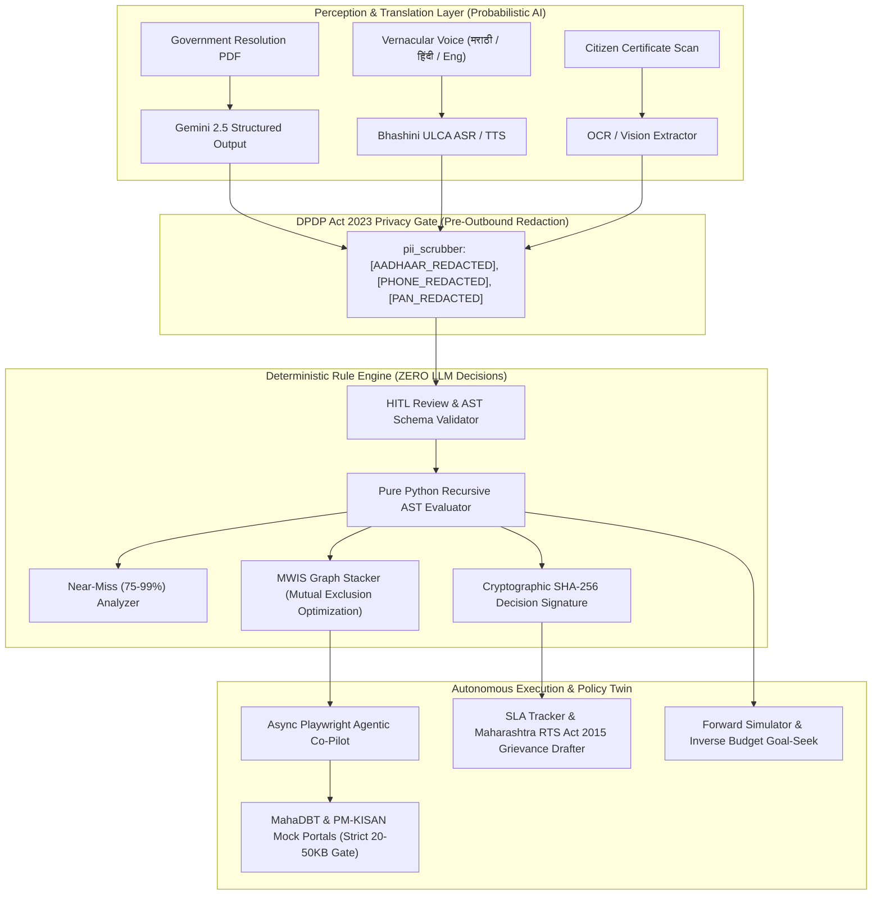

# Autonomous Agentic Citizen Welfare & Policy Intelligence Platform
### `welfare-navigator-platform`

[](https://opensource.org/licenses/MIT)
[](https://www.python.org/downloads/)
[](https://fastapi.tiangolo.com)
[](https://react.dev)
[](https://tailwindcss.com)
[](docs/SECURITY_AND_PRIVACY.md)

---

## 1. Executive Summary & Vision

The **Autonomous Agentic Citizen Welfare & Policy Intelligence Platform** (`welfare-navigator-platform`) is an end-to-end, privacy-preserving governance platform designed to bridge the gap between complex Indian welfare policies (Central and State Governments, with special focus on Maharashtra) and eligible citizens.

Traditional welfare discovery systems suffer from four fundamental failures:
1. **Unstructured Gazette Traps:** Policies are published as legalistic Government Resolution (GR) PDFs that citizens cannot decipher.
2. **LLM Hallucination Injustice:** Asking generative LLMs directly to determine statutory eligibility leads to hallucinations, false promises, or wrongful denials without legal accountability.
3. **Execution Chasm:** Even when citizens identify a scheme, document preparation bottlenecks (strict portal file-size brackets, minor name spelling variations, expired revenue certificates) and opaque portal submission processes prevent completion.
4. **Administrative Policy Blindness:** Department secretaries and District Collectors lack empirical digital twins to simulate budget impacts or solve for optimal criteria before issuing gazette amendments.

`welfare-navigator-platform` solves these challenges through a **strictly partitioned Neuro-Symbolic Architecture** that isolates probabilistic perception from deterministic rule execution.

---

## 2. Core Architectural Principles & Neuro-Symbolic Boundary



### Critical Non-Negotiables
- **Zero-Hallucination Eligibility Boundary:** LLMs are **never** permitted to decide whether a citizen is eligible. All verdicts (`ELIGIBLE`, `NEAR_MISS`, `INELIGIBLE`) and benefit stackings are calculated 100% deterministically by `backend/modules/rule_engine/ast_evaluator.py` and `scheme_stacker.py`, outputting condition-by-condition citations and a SHA-256 cryptographic audit signature.
- **Mandatory Human-in-the-Loop (HITL) Governance:** Every ingested Government Resolution PDF is saved with `status = 'DRAFT_HITL'`. Draft policies are strictly quarantined from citizen evaluations until an Admin inspects the side-by-side citations, reviews visual AST diffs, and triggers formal approval.
- **DPDP Act 2023 Aligned Technical Privacy:** High-precision PII scrubbing redacts 12-digit Aadhaar (`[AADHAAR_REDACTED]`), 10-digit mobile (`[PHONE_REDACTED]`), and PAN. Mobile numbers are stored only as salted SHA-256 hashes (`phone_hash`), families are linked via salted Ration Card hashes (`household_id`), and citizens have a **1-click "Purge My Citizen Vault"** option.
- **Ethical RPA & Mock Portal Isolation:** Playwright form-filling targets self-hosted clones of MahaDBT and PM-KISAN. At the verification gate, the automation pauses, streams live screenshots over WebSockets, and requires the human citizen to manually enter the OTP and CAPTCHA before final submission.

---

## 3. Subsystem Breakdown

### Module 1: Zero-Touch GR Ingestion & Rule Diffing
- **`gr_scraper.py`:** Monitors `incoming_gr_pdfs/` or gazette feeds; computes SHA-256 hashes for deduplication.
- **`pdf_to_ast.py`:** PyPDF extracts text and page numbers. Extracts title, department, benefit amount, SLA days, and criteria clauses, linking each leaf condition to page and paragraph citations.
- **`ast_differ.py`:** Computes visual Git-style AST diffs between policy versions (highlighting relaxed thresholds, added criteria, and removed exclusions).
- **`reverse_matcher.py`:** When a scheme is approved into `ACTIVE`, asynchronously evaluates the AST across all registered synthetic citizens and queues proactive WhatsApp/SMS alerts in the Outbox.

### Module 2: Vernacular Voice, Life Events & DPDP Act 2023 PII Gate
- **`pii_scrubber.py`:** High-precision regex engine that sanitizes raw text before sending to external services.
- **`bhashini_client.py`:** Adapter supporting Live Bhashini ULCA ASR/TTS and deterministic local emulation for Marathi, Hindi, and English.
- **`slot_filler.py`:** Shannon Entropy / Information Gain calculator that ranks missing demographic fields to ask the single most informative question first. Detects proactive Life Events (e.g. crop loss, child entering college, reaching age 65, birth of a daughter).

### Module 3: Deterministic Rule Engine
- **`ast_evaluator.py`:** Pure Python recursive evaluator supporting nested `AND`, `OR`, `NOT`, `EQUALS`, `NOT_EQUALS`, `IN`, `NOT_IN`, `GREATER_THAN`, `LESS_THAN`, `GREATER_EQUAL`, `LESS_EQUAL`, and `BETWEEN`. Generates cryptographic SHA-256 decision signatures.
- **`near_miss_analyzer.py`:** Evaluates ineligible conditions to detect 75%–99% weighted partial matches, synthesizing concrete remediation steps (e.g., "Renew expired income certificate at Tehsil to unlock ₹35,000 benefit").
- **`scheme_stacker.py`:** Formulates scheme stacking as a Maximum Weight Independent Set (MWIS) on an undirected conflict graph using `networkx`, resolving statutory mutual exclusions to maximize total financial payout for the individual and household.

### Module 4: Pre-Flight Document Auditor & Quality Gate
- **`vision_ocr.py`:** Document OCR extractor with PII redaction.
- **`cross_validator.py`:** RapidFuzz `token_sort_ratio` cross-validator between citizen profile name and document name (flags scores < 85 and auto-generates a standardized Self-Declaration / Affidavit PDF). Compares certificate validity against reference date (`2026-10-22`). Computes Laplacian blur score.
- **`media_compressor.py`:** Binary-search Pillow compressor that iteratively adjusts JPEG quality and scale factor to strictly fit within the government portal bracket ([20KB, 50KB]).

### Module 5: Agentic RPA Co-Pilot & Mock Portals
- **`playwright_runner.py`:** Async Playwright worker with WebSocket event streaming.
- **Human-in-the-Loop OTP/CAPTCHA Handoff:** Pauses at the verification screen, streams a live screenshot over WebSocket to the browser, awaits citizen input, and resumes execution.
- **`receipt_scraper.py`:** Downloads official confirmation tracking ID (`MHA-2026-XXXXXX`) and generates a verifiable acknowledgment PDF receipt.
- **`mock_gov_portals/server.py`:** Self-hosted FastAPI server running MahaDBT and PM-KISAN clones with strict 20KB-50KB file validation and dynamic CAPTCHA/OTP challenges.

### Module 6: SLA Tracker & Policy Twin Sandbox
- **`sla_monitor.py`:** Tracks statutory service delivery timelines against the Maharashtra Right to Public Services Act, 2015. Automatically flags breaches when `days_elapsed > sla_days`.
- **`grievance_drafter.py`:** Drafts formal legal Form-1 First Appeal PDFs citing Section 9(1) statutory penalties (up to ₹5,000 fine on default officers).
- **`policy_simulator.py`:**
  - *Forward What-If Sandbox:* Allows administrators to adjust income ceilings, landholding limits, and caste categories, calculating net new beneficiaries and state budget shifts across all synthetic citizens.
  - *Inverse Budget Goal-Seek:* Given a target expenditure budget, runs binary search to solve for the exact income cutoff that maximizes coverage without overshooting.

---

## 4. Repository Structure

```text
welfare-navigator-platform/
├── docker-compose.yml                  # PostgreSQL 16, Redis 7, Celery, FastAPI, Mock Portals, Frontend
├── .env.example                        # Template for DB, AI, and cryptographic salt
├── .env                                # Local development environment configuration
├── Makefile                            # Shortcuts for setup, dev, test, seed, demo-artifacts
├── README.md                           # Comprehensive documentation & demo playbook
├── docs/
│   ├── ARCHITECTURE.md                 # System design & Neuro-Symbolic boundary
│   ├── ROADMAP_AND_STATUS.md           # Implementation & verification checklist
│   ├── DECISION_LOG.md                 # Autonomous technical decisions
│   ├── API_SPECIFICATION.md            # REST & WebSocket API contracts
│   └── SECURITY_AND_PRIVACY.md         # DPDP Act 2023 technical alignment
├── sample_artifacts/                   # Auto-generated synthetic test assets
│   ├── Artifact_A_Maharashtra_GR_2026.pdf
│   ├── Artifact_B1_IdentityCard_Ramesh_Shamrao_Patil.jpg
│   ├── Artifact_B2_IncomeCert_Ramesh_S_Patil_Expired2023.jpg
│   ├── Artifact_B3_Valid_Caste_Cert.jpg
│   └── generate_artifacts.py
├── backend/
│   ├── Dockerfile
│   ├── requirements.txt
│   ├── pytest.ini
│   ├── main.py                         # FastAPI entrypoint, routers, WebSocket mounts
│   ├── config.py                       # Pydantic settings & reference date
│   ├── celery_app.py                   # Celery worker configuration (with BackgroundTasks fallback)
│   ├── database/
│   │   ├── connection.py               # Async/Sync SQLAlchemy engine (Postgres + SQLite fallback)
│   │   ├── models.py                   # Citizen, Scheme, Application, AuditLog, Notification
│   │   ├── models.sql                  # Raw DDL schema with JSONB & GIN indexes
│   │   ├── seed.py                     # Populates 20 schemes + 50 citizens + 15 households
│   │   └── seed_schemes.json           # 20 rich Central & Maharashtra welfare schemes
│   ├── modules/
│   │   ├── ingestion/                  # GR Scraper, PDF-to-AST, AST Differ, Reverse Matcher
│   │   ├── voice_profile/              # PII Scrubber, Bhashini Client, Entropy Slot-Filler
│   │   ├── rule_engine/                # Recursive AST Evaluator, Near-Miss, MWIS Graph Stacker
│   │   ├── doc_auditor/                # Vision OCR, RapidFuzz Cross-Validator, 20-50KB Compressor
│   │   ├── rpa_copilot/                # Playwright Worker, DOM Mappings, Receipt Scraper
│   │   └── tracker_twin/               # SLA Monitor, RTS Grievance Drafter, Policy Simulator
│   └── tests/                          # 21 comprehensive pytest test cases
├── mock_gov_portals/                   # Self-hosted MahaDBT & PM-KISAN portal clones
│   ├── Dockerfile
│   ├── server.py                       # FastAPI server enforcing 20KB-50KB and OTP challenge
│   ├── mahadbt_clone/                  # Multi-step scholarship portal HTML/JS
│   └── pmkisan_clone/                  # Farmer registration portal HTML/JS
└── frontend/                           # React 18 (Vite) + Tailwind CSS + Lucide Icons
    ├── Dockerfile
    ├── package.json
    ├── vite.config.js
    ├── index.html
    └── src/
        ├── App.jsx                     # 4 Roles switcher + Outbox drawer
        ├── api/client.js               # Typed API, WebSocket client & IndexedDB queue
        ├── components/                 # Navbar, OutboxDrawer
        └── pages/                      # CitizenWorkspace, DocumentVault, LiveCoPilotModal,
                                        # ApplicationTracker, AdminIngestion, AuthorityDashboard
```

---

## 5. Quick Start & Execution Guide

### Prerequisites
- Python 3.11+
- Node.js 18+ and npm
- (Optional) Docker and Docker Compose

### Step 1: Environment Setup
```bash
# From workspace root:
cd welfare-navigator-platform

# 1. Setup Backend Python Environment
python -m venv venv
# On Windows PowerShell:
.\venv\Scripts\Activate.ps1
# On Linux/macOS:
source venv/bin/activate

pip install -r backend/requirements.txt

# 2. Setup Frontend Environment
cd frontend
npm install
cd ..
```

### Step 2: Seed Database & Generate Sample Artifacts
```bash
# Seed 20 Schemes, 50 Synthetic Citizens, and Sample Applications
python backend/database/seed.py

# Generate Sample PDF GR and Synthetic Certificates
python sample_artifacts/generate_artifacts.py
```

### Step 3: Run Full Automated Backend Test Suite
```bash
pytest backend/tests -v
```
*Expected: 21 passed in ~1.5s.*

### Step 4: Launch Dev Services
In separate terminal windows:
```bash
# Terminal 1: Backend API (Port 8000)
python backend/main.py

# Terminal 2: Mock Government Portals (Port 8001)
python mock_gov_portals/server.py

# Terminal 3: Frontend (Port 5173)
cd frontend
npm run dev
```
Open your browser to `http://localhost:5173`.

### Step 5: (Alternative) Single-Command Docker Deployment
```bash
docker-compose up -d
```

---

## 6. End-to-End Live Demo Playbook

Follow these structured demonstration scenarios to experience the platform end-to-end:

### Scenario 1: Citizen Discovery & MWIS Optimization (Persona: Ramesh Shamrao Patil)
1. Open `http://localhost:5173` in **Citizen Portal** mode.
2. Select **Ramesh Shamrao Patil** (Farmer, 2.5 acres, ₹1,80,000 income, Kolhapur).
3. Observe the **Vernacular Voice/Text Assistant**:
   - Click the chip **🌾 पीक नुकसान (Crop Loss)** or type a vernacular message.
   - Observe the **`[PII CLEAN]`** badge confirming that Aadhaar/mobile credentials have been scrubbed before processing.
   - Notice the **Next Question** banner displaying the attribute with highest Shannon Information Gain.
4. Review the **Eligible Schemes Tab**:
   - See **PM-KISAN Samman Nidhi** and **Namo Shetkari Mahasanman Nidhi**.
   - Click **View SHA-256 Decision Receipt** to inspect the 64-character tamper-evident audit hash.
5. Review the **Optimal Benefit Stack Tab**:
   - Inspect how the Maximum Weight Independent Set solver maximizes annual payout (₹56,000/yr) and details resolved statutory mutual exclusions.

### Scenario 2: Pre-Flight Document Quality Gate & 20KB–50KB Compressor
1. Switch to the **Document Vault & Compressor** sub-tab.
2. Under **Load Pre-Configured Test Artifacts**, click **Artifact_B2: Expired Income Cert 2023**:
   - **RapidFuzz Cross-Validation:** The system flags that the document name ("Ramesh S. Patil") has a token sort ratio of 82.5% (< 85 threshold) against the profile name ("Ramesh Shamrao Patil").
   - **Automated Affidavit PDF:** Click **Download Pre-Filled Name Mismatch Affidavit PDF** to view the generated statutory self-declaration.
   - **Expiry Gate:** Red alert banner: certificate expired on `2023-03-31` (over 1,000 days overdue against reference date `2026-10-22`).
3. Click **1-Click Compress to 20KB-50KB**:
   - Watch the Pillow binary-search compressor reduce the file into the exact [20KB, 50KB] bracket (e.g., 38.4 KB) with a green **PORTAL COMPLIANT** badge.

### Scenario 3: Agentic RPA Co-Pilot with Human-in-the-Loop Handoff
1. Go back to the **Eligible Schemes** tab and click **1-Click Apply (Agentic Co-Pilot)** on a scheme.
2. The **Live RPA Co-Pilot Modal** opens:
   - Click **Start Automated Form-Filling Co-Pilot**.
   - Watch the Playwright runner navigate to the mock portal (`http://localhost:8001/mahadbt`), populate Step 1 (Personal Details), and upload the compressed certificate in Step 2.
   - **Mandatory HITL Gate:** At Step 3, the automation pauses. The live browser stream shows the CAPTCHA and simulated SMS OTP.
   - Review the pre-populated OTP and CAPTCHA, click **Authorize & Resume Submission**.
   - Playwright enters the verified credentials, completes submission, and extracts the tracking ID (e.g. `MHA-2026-894123`).
   - Click **Download Verifiable Receipt PDF**.

### Scenario 4: Statutory SLA Breach & Maharashtra RTS Act 2015 Grievance
1. Click the **RTS Act SLA Tracker** sub-tab.
2. View the timeline bar for **Aditya Patil's MahaDBT Scholarship**:
   - Submitted 52 days ago with a 45-day statutory SLA &rarr; Flagged in red as **`SLA BREACHED (+7 Days Overdue)`**.
3. Click **1-Click Draft RTS Grievance Appeal**:
   - Generates the legal Form-1 First Appeal PDF citing Section 9(1) of Maharashtra Act No. XXXI of 2015 (statutory penalty up to ₹5,000). Click **Download Form-1 Appeal PDF**.

### Scenario 5: Administrative GR Ingestion & HITL Approval
1. Switch to the **Scheme Admin (HITL)** role in the top navigation.
2. Click **Ingest Maha Krishi Urja GR 2026 PDF**:
   - The PDF-to-AST compiler translates the gazette prose into an executable boolean AST.
   - Status is set to **`DRAFT_HITL`** (quarantined from citizen discovery).
   - Side-by-side view shows page citations alongside candidate AST JSON.
   - Review the **Visual Git-Style AST Diff** displaying relaxed income thresholds.
3. Click **Approve Scheme & Activate**:
   - Transitions status to `ACTIVE`.
   - Triggers asynchronous reverse-matching across all 50 synthetic citizens.
   - Click the **Outbox** button in the navbar to see the proactive WhatsApp messages queued for eligible farmers.

### Scenario 6: District Collector Policy Twin & Inverse Budget Goal-Seek
1. Switch to the **District Collector (Twin)** role.
2. Adjust the **Annual Family Income Ceiling** slider (e.g. from ₹2,50,000 to ₹4,50,000):
   - Watch beneficiary count, state budget impact, and district breakdowns update dynamically.
3. Test the **Inverse Budget Goal-Seek Optimizer**:
   - Enter a target expenditure budget (e.g. `₹2,50,000`).
   - Click **Calculate Optimal Income Cutoff**: binary search identifies the exact income cutoff that maximizes beneficiary coverage within budget.

---

## 7. Security & Compliance Summary (DPDP Act 2023 Aligned)

| Safeguard | Technical Implementation | File Reference |
| :--- | :--- | :--- |
| **Notice & Affirmative Consent** | Section 6 compliance; records `consent_granted` & timestamp | `backend/database/models.py` |
| **Aadhaar, Mobile & PAN Redaction** | Replaces credentials with non-numeric tags before LLM transmission | `backend/modules/voice_profile/pii_scrubber.py` |
| **Contact Data Minimization** | Salted SHA-256 telephone hash (`phone_hash`) | `backend/modules/voice_profile/pii_scrubber.py` |
| **Household Privacy Linkage** | Salted SHA-256 Ration Card hash (`household_id`) | `backend/modules/voice_profile/pii_scrubber.py` |
| **Right to Erasure ("Purge Vault")** | 1-click cryptographic wipe of citizen records, documents, and logs | `DELETE /api/v1/citizens/{id}/purge` |
| **Decision Auditability** | SHA-256 hash signing citizen data, statutory rule AST, verdict, and timestamp | `backend/modules/rule_engine/ast_evaluator.py` |
| **Mandatory HITL Governance** | Ingested policies start in `DRAFT_HITL` and require admin sign-off | `backend/modules/ingestion/pdf_to_ast.py` |
| **Ethical RPA Isolation** | Targets mock portals only; pauses for human OTP/CAPTCHA entry | `backend/modules/rpa_copilot/playwright_runner.py` |

---

## 8. License
Distributed under the MIT License. Developed autonomously inside Google Antigravity.
