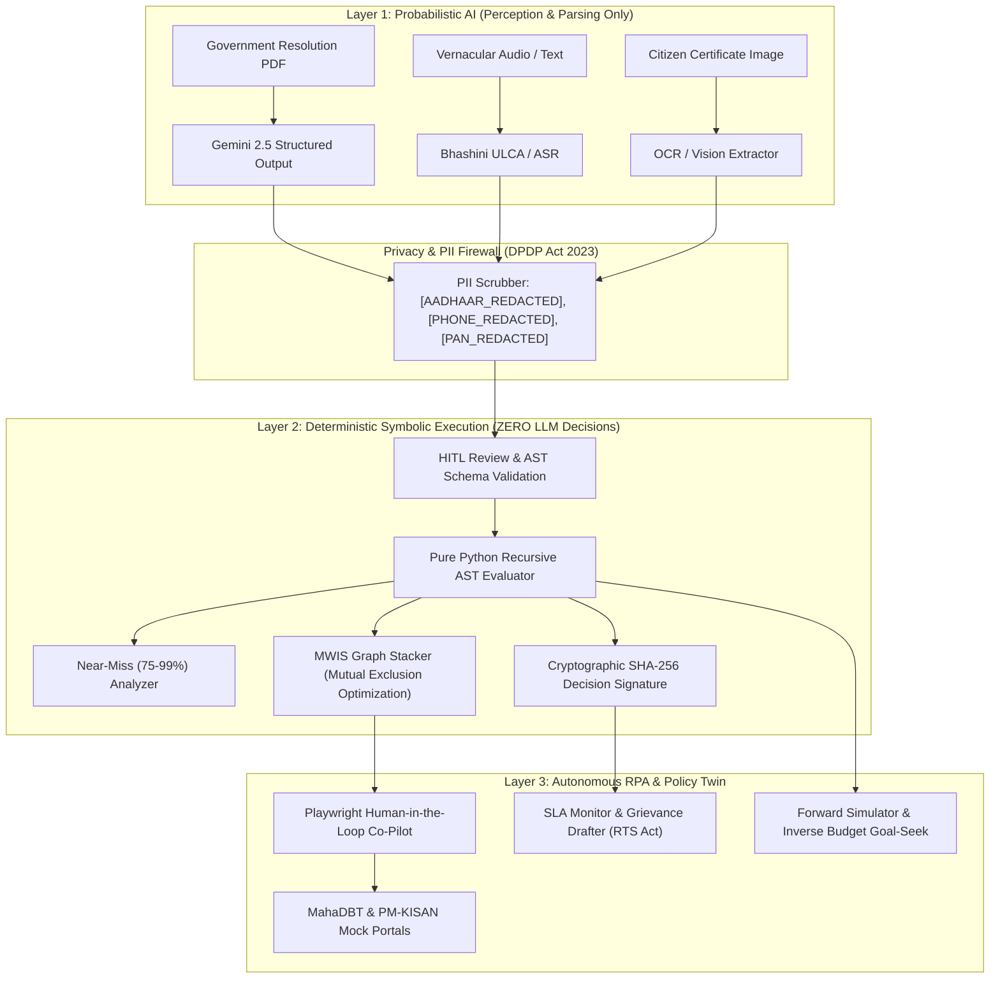

# System Architecture & Neuro-Symbolic Boundary Specification

## 1. High-Level Vision & Purpose
The **Autonomous Agentic Citizen Welfare & Policy Intelligence Platform** (`welfare-navigator-platform`) is an end-to-end, privacy-preserving governance system designed to proactively bridge the gap between Indian welfare policies (Central & State Governments) and eligible citizens.

Traditional welfare discovery suffers from:
1. Complex, fragmented Government Resolutions (GRs) buried in unstructured PDFs.
2. Inaccurate LLM hallucinations when asked to evaluate complex statutory eligibility rules.
3. Lack of end-to-end execution—citizens are told they are eligible but face prohibitive document preparation bottlenecks and opaque portal submission interfaces.
4. Policy makers operating in silos without empirical forward simulation of rule changes or inverse budget optimization.

`welfare-navigator-platform` solves these foundational problems using a **strictly partitioned Neuro-Symbolic Architecture**.

---

## 2. Neuro-Symbolic Boundary: The Zero-Hallucination Law
A core tenet of this platform is the absolute separation between **probabilistic perception/translation** and **deterministic rule execution**:



### Architectural Guardrails
1. **No LLM Eligibility Judgments:** An LLM is never invoked to evaluate "Is Ramesh Patil eligible for PM-KISAN?". Eligibility is evaluated by `modules/rule_engine/ast_evaluator.py`, executing nested boolean logic ASTs deterministically.
2. **Every Decision Has a Cryptographic Receipt:** Every evaluation generates a SHA-256 hash derived from the exact citizen attributes, the scheme AST, the verdict, and the evaluation timestamp, backed by direct page/clause citations.
3. **Mandatory Human-in-the-Loop (HITL):** Ingested schemes remain in `DRAFT_HITL` until approved by an Admin. They are quarantined from citizen matching.

---

## 3. Core Subsystems & Data Flow

### Module 1: Zero-Touch GR Ingestion & Rule Diffing
- **GR Scraper:** Ingests Government Resolution PDFs from `incoming_gr_pdfs/` or simulated gazette feeds. Calculates SHA-256 file hashes to prevent duplicate ingestion.
- **PDF-to-AST Compiler:** PyMuPDF extracts text, tables, and page boundaries. Gemini Structured Output (with deterministic local fallback) transforms unstructured administrative prose into an executable JSON AST:
  ```json
  {
    "operator": "AND",
    "children": [
      {"field": "annual_income", "operator": "LESS_EQUAL", "value": 250000, "citation": {"page": 2, "clause": "Para 4(a)"}},
      {"field": "landholding_acres", "operator": "LESS_EQUAL", "value": 5.0, "citation": {"page": 3, "clause": "Para 5(b)"}}
    ]
  }
  ```
- **AST Differ:** Uses structural recursive tree diffing to compare amended policies against previous versions, highlighting changed thresholds in green/red Git-style format.
- **Reverse Matcher:** When a scheme moves to `ACTIVE`, executes asynchronous batch evaluation across all registered synthetic citizens, queuing proactive WhatsApp/SMS notifications for newly eligible individuals.

### Module 2: Vernacular Voice, Life Events & PII Gate
- **Bhashini ULCA Client:** Real-time speech-to-text and text-to-speech adapter covering Marathi, Hindi, and English with automatic fallback to deterministic phoneme generation or Web Speech API.
- **DPDP Act 2023 PII Scrubber:** Strips 12-digit Aadhaar (`[AADHAAR_REDACTED]`), 10-digit mobile numbers (`[PHONE_REDACTED]`), and PAN cards. Stores phone numbers only as salted SHA-256 hashes (`phone_hash`) and families under salted Ration Card hashes (`household_id`).
- **Entropy-Driven Slot Filler:** Calculates missing demographic fields ranked by maximum Shannon information gain to minimize citizen questioning burden. Identifies proactive Life Events (e.g. crop loss, high school admission, reaching age 60).

### Module 3: Deterministic Rule Engine
- **Recursive AST Evaluator:** Evaluates `AND`, `OR`, `NOT`, `EQUALS`, `NOT_EQUALS`, `IN`, `NOT_IN`, `GREATER_THAN`, `LESS_THAN`, `GREATER_EQUAL`, `LESS_EQUAL`, `BETWEEN`.
- **Near-Miss Analyzer:** For citizens falling short of 100% eligibility, computes proximity scores (75%–99%) and generates concrete remediation actions (e.g., "Renew expired income certificate", "Income exceeds ceiling by ₹10,000").
- **Maximum Weight Independent Set (MWIS) Graph Stacker:** Models mutual exclusions between schemes (e.g., cannot combine duplicate scholarship schemes across departments). Formulates a graph where vertices are eligible schemes with financial weights and edges represent statutory conflicts. NetworkX solves the MWIS to maximize monetary payout for both the individual and the household.

### Module 4: Pre-Flight Document Auditor & Quality Gate
- **Vision OCR:** Extracts identity, income, caste, and validity dates with automated PII masking.
- **RapidFuzz Cross-Validator:** Compares document name variations (e.g., "Ramesh Shamrao Patil" vs "Ramesh S. Patil") using `token_sort_ratio`. Flags scores < 85 and automatically prepares a standardized Self-Declaration / Affidavit PDF.
- **Expiry Validator:** Assesses validity dates against current reference time (`2026-10-22`). Flags expired certificates.
- **Laplacian Blur Quality Gate:** Computes image variance to reject unreadable scans before submission.
- **Media Compressor:** Binary search JPEG/PNG resizer using Pillow that enforces government portal upload thresholds (strictly 20KB – 50KB).

### Module 5: Agentic RPA Co-Pilot & Mock Portals
- **Playwright Runner:** Automates DOM interactions on self-hosted clones of MahaDBT and PM-KISAN portals.
- **Human-in-the-Loop OTP & CAPTCHA Handoff:** When encountering CAPTCHA or OTP gates, the Playwright process pauses, streams a live screenshot over WebSocket to the citizen UI, and resumes only when the human enters the 6-digit code.
- **Receipt Scraper:** Downloads confirmation tracking receipts (`MHA-2026-XXXXX`).

### Module 6: SLA Tracker & Policy Twin Sandbox
- **SLA Monitor:** Tracks statutory deadlines under the Maharashtra Right to Services (RTS) Act 2015. Automatically marks applications as `BREACHED` when `days_elapsed > sla_days`.
- **Grievance Drafter:** Produces a ready-to-file legal PDF complaint under the RTS Act and CPGRAMS with statutory penalty citations.
- **Policy Twin Forward Simulator:** Empirically calculates budget and beneficiary shifts when government administrators tweak eligibility parameters.
- **Inverse Budget Goal-Seek Optimizer:** Computes the optimal threshold adjustments needed to hit a predetermined target budget or beneficiary target.
