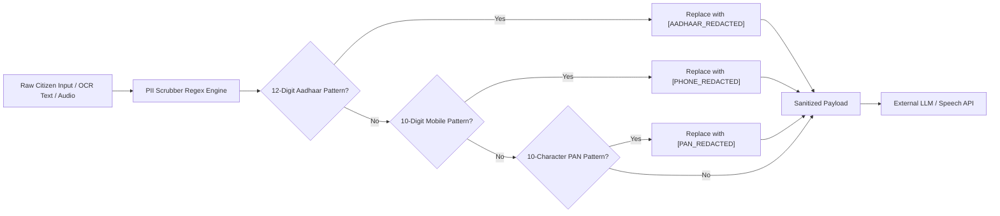

# Security Architecture & Data Privacy (DPDP Act 2023 Aligned)

## 1. Executive Summary & Legal Framework Alignment
The **Digital Personal Data Protection Act, 2023 (DPDP Act 2023)** of India mandates stringent obligations on Data Fiduciaries regarding the processing, retention, purpose limitation, and erasure of personal digital data.

`welfare-navigator-platform` implements proactive, defense-in-depth technical privacy engineering. 

> **Important Honesty & Compliance Note:** These technical safeguards are designed to embody the principles and requirements of the DPDP Act 2023 (Notice, Consent, Purpose Limitation, Data Minimization, and the Right to Erasure). They do not constitute formal statutory certification or legal advice.

---

## 2. PII Scrubbing & Redaction Architecture
Before any citizen inquiry, document text, or conversational transcription is dispatched outside the internal application perimeter (e.g. to Google Gemini or Bhashini), it passes through `modules/voice_profile/pii_scrubber.py`.

### Redaction Rules
- **Aadhaar Numbers:** Any sequence matching `\b[2-9]\d{3}[\s-]?\d{4}[\s-]?\d{4}\b` is replaced with `[AADHAAR_REDACTED]`. Raw or partially masked Aadhaar numbers are never logged or stored.
- **Mobile Numbers:** Any sequence matching Indian mobile conventions `\b(?:\+91|0)?[6-9]\d{9}\b` is replaced with `[PHONE_REDACTED]`.
- **Permanent Account Numbers (PAN):** Any sequence matching `\b[A-Z]{5}[0-9]{4}[A-Z]{1}\b` is replaced with `[PAN_REDACTED]`.

---

## 3. Cryptographic Hashing for Identity & Household Linkage
To adhere to the principle of Data Minimization without breaking longitudinal tracking:
1. **Phone Hash:** Citizen phone numbers are converted to irreversible cryptographic digests using a salted SHA-256 algorithm:
   $$\text{phone\_hash} = \text{SHA256}(\text{phone} + \text{SECRET\_SALT})$$
2. **Household Hash:** Family members are linked without exposing national identity credentials using a salted Ration Card hash:
   $$\text{household\_id} = \text{SHA256}(\text{ration\_card\_number} + \text{SECRET\_SALT})$$

This ensures that even in the event of a raw database breach, citizen contact vectors and national identity numbers cannot be reverse-engineered or enumerated.

---

## 4. Explicit Consent Architecture
Under Section 6 of the DPDP Act 2023, personal data may only be processed on the basis of clear, affirmative consent.
- The `Citizen` schema enforces `consent_granted` (Boolean) and `consent_timestamp` (ISO-8601).
- If `consent_granted` is false or revoked, all processing (eligibility evaluation, document scanning, reverse matching) is rejected with an HTTP 403 `ConsentRequiredException`.

---

## 5. Right to Erasure: "Purge My Citizen Vault"
Under Section 12(3) of the DPDP Act 2023, citizens possess the unconditional right to withdraw consent and mandate data erasure.
- Endpoint: `DELETE /api/v1/citizens/{citizen_id}/purge`
- Execution:
  1. Deletes citizen row from database.
  2. Permanently unlinks or wipes all associated uploaded documents and compressed files from disk.
  3. Purges OCR extraction records, audit trails, and notification history.
  4. Returns a verifiable cryptographic Purge Receipt confirming zero remaining byte footprint.
- UI: A 1-click prominent **"Purge My Vault"** button in both Citizen and Kiosk modes.

---

## 6. Audit Trail & Decision Integrity
Every deterministic rule engine evaluation produces a SHA-256 decision signature:
$$\text{Signature} = \text{SHA256}(\text{CitizenID} + \text{SchemeID} + \text{Verdict} + \text{RuleAST} + \text{Timestamp})$$
This prevents retroactive tampering or denial by administrative authorities.
